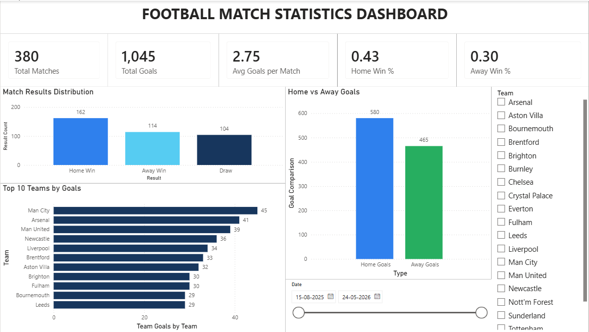

# ⚽ Football Match Statistics Dashboard

An interactive football analytics dashboard developed using **Microsoft Power BI** to analyze English Premier League 2025–26 match statistics.

## 📊 Project Overview

This project analyzes football match data to understand team performance, match results, and goal-scoring patterns. It presents important statistics through interactive KPI cards, charts, and filters.

## 🎯 Project Objectives

- Analyze football match results.
- Compare home and away team performance.
- Identify the top 10 goal-scoring teams.
- Calculate total goals and average goals per match.
- Explore match statistics using interactive filters.

## 🛠️ Tools & Technologies

- Microsoft Power BI
- Power Query
- DAX
- Microsoft Excel
- CSV Dataset

## 📈 Dashboard Features

### 1. Key Performance Indicators (KPIs)
- Total Matches: 380
- Total Goals: 1,045
- Average Goals per Match: 2.75
- Home Win Percentage
- Away Win Percentage

### 2. Match Results Distribution
Displays:
- Home Wins
- Away Wins
- Draws

### 3. Home vs Away Goals
Compares goals scored by home teams and away teams.

### 4. Top 10 Teams by Goals
Identifies the ten highest-scoring teams.

### 5. Interactive Filters
- Team Filter
- Date Range Filter

## 🖼️ Dashboard Preview

## 📂 Dataset Information

**Source:** [Football-Data.co.uk](https://www.football-data.co.uk/)

**Dataset:** English Premier League 2025–26

The dataset includes:
- Match dates
- Home and away teams
- Full-time scores
- Match results
- Shots and shots on target
- Corners, fouls and cards

## 🧠 Key Learnings

- Data cleaning and preprocessing
- Data transformation using Power Query
- Creating DAX measures
- Developing interactive dashboards
- Data visualization
- KPI creation and analysis

## 🚀 Future Improvements

- Team-wise performance analysis
- Goals by matchweek
- Highest-scoring match analysis
- Advanced team comparisons
- Improved home and away filtering

## 👨‍💻 Author

**Aryan Vijay Kharate**

B.Tech – Artificial Intelligence & Data Science

GitHub: [aryanEldorado](https://github.com/aryanEldorado)

---

⭐ If you find this project interesting, feel free to explore the repository and share your feedback!
